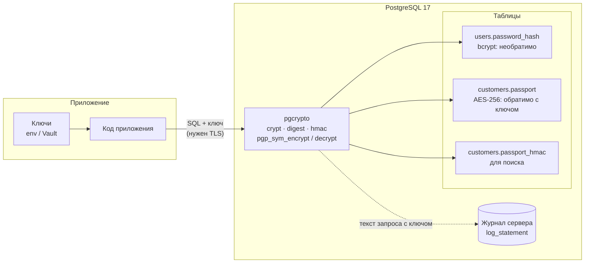
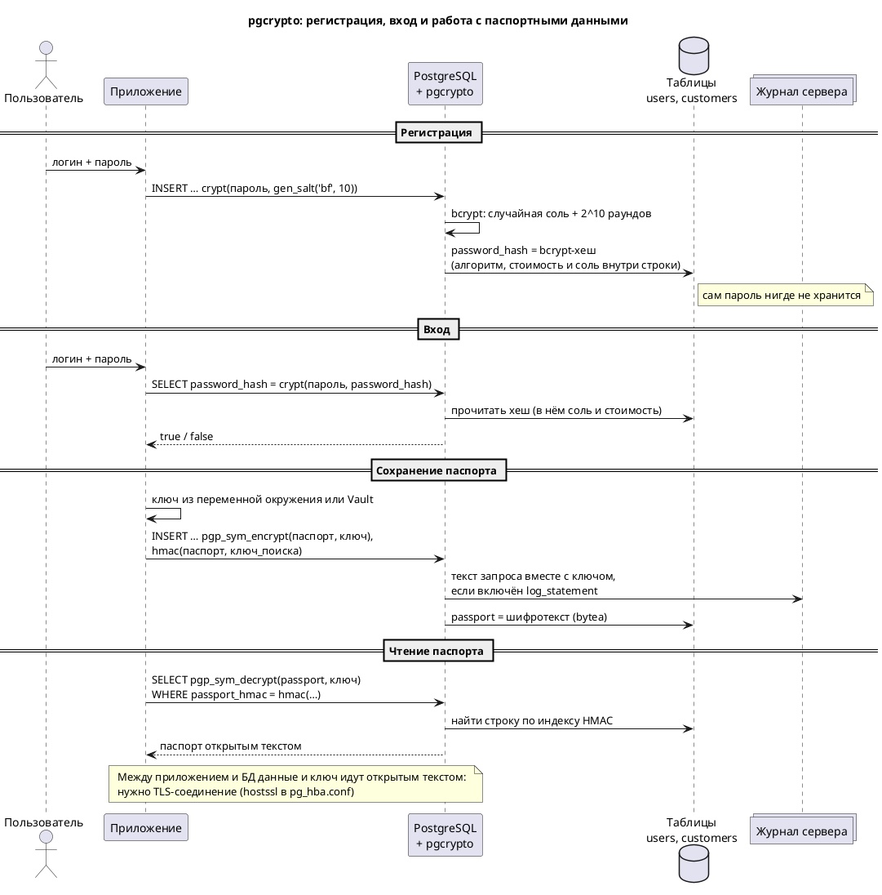

# pgcrypto: шифрование данных в PostgreSQL

> Доклад по дисциплине «Администрирование баз данных», тема №12.
> Автор: Солдатов Сергей Юрьевич, группа ПИ4-1.
>
> Демонстрация запускается двумя командами на любом компьютере с Docker.

**Содержание:**
[1. Цель и актуальность](#1-цель-и-актуальность) ·
[2. Архитектура](#2-архитектура) ·
[3. Установка и развёртывание](#3-установка-и-развёртывание) ·
[4. Демонстрация](#4-демонстрация) ·
[5. PlantUML-диаграмма](#5-plantuml-диаграмма) ·
[6. Сравнение с альтернативами](#6-сравнение-с-альтернативами) ·
[7. Ограничения и когда НЕ применять](#7-ограничения-и-когда-не-применять) ·
[8. Ссылки](#8-ссылки)

---

## 1. Цель и актуальность

**Проблема.** В базе данных хранятся пароли пользователей и персональные данные: паспорта, телефоны, номера карт.
Если они лежат открытым текстом, то утечка резервной копии, дампа или доступ постороннего к таблице сразу раскрывает всё.
Закон 152-ФЗ требует защищать персональные данные, а хранение паролей открытым текстом — грубая ошибка безопасности.

**pgcrypto** — расширение из стандартной поставки PostgreSQL. Оно добавляет в SQL криптографические функции:

| Задача | Функции | Обратимо? |
|---|---|---|
| Хранение паролей | `crypt()`, `gen_salt()` | Нет: проверяется, но не расшифровывается |
| Хеширование и контроль целостности | `digest()` (SHA-256 и др.), `hmac()` | Нет |
| Шифрование данных | `pgp_sym_encrypt()` / `pgp_sym_decrypt()`, `pgp_pub_encrypt()` / `pgp_pub_decrypt()` | Да, с ключом |
| Случайные значения | `gen_random_bytes()`, `gen_random_uuid()` | — |

**Цель доклада** — показать, как с помощью pgcrypto правильно хранить пароли и шифровать отдельные колонки,
как искать по зашифрованным данным и какие у этого подхода ограничения.

---

## 2. Архитектура

pgcrypto работает **внутри сервера PostgreSQL**: приложение передаёт в SQL-запросе данные и ключ, сервер шифрует их и пишет в таблицу.



Три ключевых приёма:

1. **Пароли хешируются bcrypt** (`crypt` + `gen_salt('bf')`). У каждого пароля своя случайная соль, поэтому одинаковые пароли дают разные хеши.
   Параметр стоимости делает перебор медленным: +1 к параметру удваивает время.
2. **Персональные данные шифруются AES-256** (`pgp_sym_encrypt`). В шифр подмешивается случайная соль,
   поэтому одинаковые значения дают разный шифротекст: по нему нельзя ни искать, ни понять, что значения совпадают.
3. **Для поиска хранится «слепой индекс»** — HMAC значения с отдельным ключом. По нему работает обычный B-tree индекс и поиск на точное совпадение.

---

## 3. Установка и развёртывание

pgcrypto входит в стандартную поставку PostgreSQL, ничего дополнительно ставить не нужно — достаточно `CREATE EXTENSION pgcrypto;`.
Начиная с PostgreSQL 13 расширение помечено как доверенное (trusted), и его может подключить не только суперпользователь, но и владелец базы с правом `CREATE`.

```bash
git clone https://github.com/Ranot27/report-pgcrypto.git
cd report-pgcrypto
```

### 3.1. Вариант A: Docker

Требуется Docker с Docker Compose v2 (Docker Desktop, OrbStack или Colima).
[docker-compose.yml](docker-compose.yml) поднимает официальный образ `postgres:17` с `log_statement = all`.

```bash
docker compose up -d --wait
docker compose exec db psql -U demo -d demo -f /sql/demo.sql
```

Интерактивная консоль: `docker compose exec db psql -U demo -d demo`. Остановить стенд: `docker compose down`.

### 3.2. Вариант B: локальная установка без Docker (macOS, Homebrew)

Так демонстрация запускалась при подготовке доклада: вывод в разделе 4 получен этим способом.

```bash
brew install postgresql@17
export PATH="/opt/homebrew/opt/postgresql@17/bin:$PATH" LC_ALL=en_US.UTF-8

# отдельный учебный кластер с журналированием всех запросов
initdb -D ~/pgcrypto-demo/data -U demo --auth=trust -E UTF8 --locale=en_US.UTF-8
pg_ctl -D ~/pgcrypto-demo/data -l ~/pgcrypto-demo/server.log -o "-c log_statement=all" -w start
createdb -U demo demo

psql -U demo -d demo -f sql/demo.sql
```

Остановить сервер: `pg_ctl -D ~/pgcrypto-demo/data stop`. На Linux вместо Homebrew — пакет `postgresql-17` из репозитория PGDG.

Подключение из DBeaver в обоих вариантах: `localhost:5432`, база `demo`, пользователь `demo` (в варианте A пароль `demo`).

<details>
<summary>Структура репозитория</summary>

```
report-pgcrypto/
├── README.md            ← доклад
├── docker-compose.yml
├── sql/
│   └── demo.sql         ← демонстрационный скрипт
├── output/              ← реальный вывод demo.sql и строка журнала с ключом
├── diagrams/
│   ├── arch.puml        ← PlantUML: последовательность операций
│   └── flow.md          ← Mermaid: где и чем защищены данные
└── screenshots/
```
</details>

---

## 4. Демонстрация

Скрипт [sql/demo.sql](sql/demo.sql) выполняется целиком одной командой. Ниже — ключевые шаги и реальный вывод
(PostgreSQL 17.12, pgcrypto 1.3, macOS). Полный вывод скрипта: [output/demo_output.txt](output/demo_output.txt).

### 4.1. Пароли: одинаковый пароль → разные хеши

```sql
INSERT INTO users (login, password_hash) VALUES
    ('ivanov', crypt('qwerty123', gen_salt('bf', 10))),
    ('petrov', crypt('qwerty123', gen_salt('bf', 10)));

SELECT login, password_hash FROM users;
```

```text
 login  |                        password_hash
--------+--------------------------------------------------------------
 ivanov | $2a$10$lSWt/FFykueqzfwxbLLAwut5Ro/.RZknnT6MFV0w8yu1T4JmkskGa
 petrov | $2a$10$7YKmwt6u0qVJ89RnEo/TGO/gZ.rigaI2XUBeqYFB34SrdW6zurpg2
```

Пароль одинаковый, а хеши разные. `$2a$` — алгоритм bcrypt, `10` — стоимость, следующие 22 символа — соль, остальное — хеш.

Проверка пароля при входе. Соль и стоимость `crypt()` берёт из сохранённого хеша:

```sql
SELECT login,
       password_hash = crypt('qwerty123', password_hash) AS correct_password,
       password_hash = crypt('qwerty124', password_hash) AS wrong_password
FROM users;
```

```text
 login  | correct_password | wrong_password
--------+------------------+----------------
 ivanov | t                | f
 petrov | t                | f
```

Цена перебора: `gen_salt('bf', 6)` против `gen_salt('bf', 12)` (время из `\timing`):

```text
 $2a$06$nYHonkbCzpNbipy6CGTlXuGZhaVii47vGqw0eKUvFLr6NtUJfmMZC
Time: 10.784 ms

 $2a$12$cLcEnBzrnaaTeAStozU1jecy4O4w9X8JFjLO/RVEmOk4fuzpg7xza
Time: 416.317 ms
```

Теоретически стоимость 12 дороже стоимости 6 в 2^6 = 64 раза; в этом прогоне вышло примерно в 40 раз (одиночный замер шумный, в другом прогоне получилось около 100).
Для пользователя доли секунды на вход незаметны, а перебор миллиардов паролей становится практически невозможным.

### 4.2. Шифрование паспорта

```sql
INSERT INTO customers (full_name, passport, passport_hmac) VALUES
    ('Иванов Иван',
     pgp_sym_encrypt('4510 123456', :'enc_key', 'cipher-algo=aes256'),
     hmac('4510 123456', :'hmac_key', 'sha256'));
```

Как данные лежат в таблице — нечитаемые байты:

```text
 id |   full_name   |             passport_on_disk              | bytes
----+---------------+-------------------------------------------+-------
  1 | Иванов Иван   | c30d04090302165486947568f9b67fd23c018e48… |    77
  2 | Петрова Мария | c30d04090302f1e8e2f8194e8d5b73d23c013b2c… |    77
  3 | Сидоров Пётр  | c30d040903021b5055706d77d1b07cd23c01da41… |    77
```

11 символов паспорта превратились в 77 байт шифротекста: это заголовки формата OpenPGP, соль и контрольная сумма.

Один и тот же паспорт у клиентов 1 и 3 зашифрован по-разному (`ciphertexts_equal = f`), а с ключом расшифровывается:

```sql
SELECT id, full_name, pgp_sym_decrypt(passport, :'enc_key') AS passport FROM customers;
```

```text
 id |   full_name   |  passport
----+---------------+-------------
  1 | Иванов Иван   | 4510 123456
  2 | Петрова Мария | 4512 654321
  3 | Сидоров Пётр  | 4510 123456
```

### 4.3. Поиск по зашифрованному полю

```sql
SELECT id, full_name, pgp_sym_decrypt(passport, :'enc_key') AS passport
FROM customers
WHERE passport_hmac = hmac('4510 123456', :'hmac_key', 'sha256');
```

```text
 id |  full_name   |  passport
----+--------------+-------------
  1 | Иванов Иван  | 4510 123456
  3 | Сидоров Пётр | 4510 123456
```

С неверным ключом расшифровка невозможна:

```text
psql:sql/demo.sql:96: ERROR:  Wrong key or corrupt data
```

### 4.4. Ключ попадает в журнал сервера

На стенде включён `log_statement = all`. Ключ передаётся внутри SQL-запроса, поэтому сервер записывает его в журнал:

```bash
docker compose logs db | grep pgp_sym_encrypt        # вариант A
grep pgp_sym_encrypt ~/pgcrypto-demo/server.log      # вариант B
```

```text
2026-11-19 13:50:06.079 MSK [15276] LOG:  statement: INSERT INTO customers (full_name, passport, passport_hmac) VALUES
	    ('Иванов Иван',   pgp_sym_encrypt('4510 123456', 'demo-encryption-key-change-me', 'cipher-algo=aes256'), hmac('4510 123456', 'demo-search-key-change-me', 'sha256')),
```

В журнале открытым текстом лежат и паспорт, и оба ключа.

Это главный риск pgcrypto. Он подробно разобран в разделе 7.

Текстовый вывод — в [output/](output/), снимки экрана работающей системы — в [screenshots/](screenshots/).

---

## 5. PlantUML-диаграмма

Диаграмма последовательности: регистрация, вход и работа с паспортными данными. Исходник: [diagrams/arch.puml](diagrams/arch.puml).

GitHub не рендерит PlantUML сам. Посмотреть диаграмму можно на [plantuml.com/plantuml](https://www.plantuml.com/plantuml), в плагине PlantUML для VS Code или IntelliJ,
либо собрать PNG командой `docker run --rm -v "$PWD/diagrams:/data" plantuml/plantuml -tpng /data/arch.puml`.



---

## 6. Сравнение с альтернативами

| Характеристика | **pgcrypto** | Шифрование в приложении | Шифрование диска / TDE |
|---|---|---|---|
| Где шифруются данные | На сервере БД | В приложении, до отправки в БД | На уровне файлов или диска |
| Что защищает | Отдельные колонки | Отдельные поля | Все файлы БД целиком |
| Видит ли ключ сервер БД | **Да**: ключ приходит в запросе | Нет | Да, ключ хранится у сервера |
| Защита от DBA и суперпользователя | Нет, если ключ проходит через сервер | Да | Нет: для пользователей БД данные прозрачны |
| Защита от кражи дампа или бэкапа | Да, для зашифрованных колонок | Да | Нет для логического `pg_dump`, да для физических копий |
| Поиск и индексы по зашифрованному полю | Только точное совпадение через HMAC | Только точное совпадение через HMAC | Без ограничений: шифрование прозрачно |
| Изменения в коде | Только SQL-запросы | Код шифрования в каждом сервисе | Никаких |
| Доступность в PostgreSQL | Стандартная поставка | Любая библиотека (libsodium, Tink и др.) | В ванильном PostgreSQL TDE нет; есть в форках (Percona pg_tde, Postgres Pro Enterprise) или через шифрование диска ОС (LUKS, BitLocker) |
| Хранение паролей | `crypt()` + bcrypt | bcrypt или argon2 в коде | Не решает задачу |

**Вывод:** pgcrypto — самый быстрый способ закрыть хранение паролей и шифрование отдельных полей без изменений в архитектуре.
Если важна защита от администратора БД, шифровать нужно в приложении. Шифрование диска дополняет оба подхода, но не заменяет их.

---

## 7. Ограничения и когда НЕ применять

- **Ключ проходит через сервер.** Он виден в тексте запроса: в журнале при `log_statement`, в `pg_stat_activity` и в `pg_stat_statements`.
  Администратор БД или злоумышленник с доступом к серверу может его получить.
  Частично помогает отключить журналирование для этой роли (`ALTER ROLE app SET log_statement = 'none'`), но полностью риск устраняет только шифрование в приложении.
- **Без TLS данные и ключ идут по сети открытым текстом.** В документации PostgreSQL прямо сказано, что pgcrypto нужно использовать вместе с SSL (`hostssl` в `pg_hba.conf`).
- **Нельзя хранить ключ в той же БД.** Тогда злоумышленник получит его вместе с данными.
- **Поиск, сортировка и индексы по зашифрованной колонке невозможны.** Остаётся только точное совпадение через HMAC. Поиск по диапазону или по части строки (`LIKE`) не работает.
- **Накладные расходы.** Шифротекст `bytea` заметно длиннее исходного значения, а шифрование и bcrypt нагружают процессор сервера БД.
- **Ротация ключа** требует перешифровать все строки.
- **152-ФЗ и государственные системы.** В стандартном pgcrypto нет ГОСТ-алгоритмов, и он не является сертифицированным средством криптозащиты.
  Там, где по требованиям регулятора нужны сертифицированные СКЗИ, pgcrypto недостаточно.

**Когда НЕ применять:** если нужна защита от администратора БД; если по зашифрованным данным нужен поиск по диапазону или подстроке;
если нужно зашифровать всю базу целиком (тогда — шифрование диска или TDE); если регулятор требует сертифицированные СКЗИ.

---

## 8. Ссылки

- [Документация PostgreSQL 17: pgcrypto](https://www.postgresql.org/docs/17/pgcrypto.html)
- [Документация PostgreSQL 17: защищённые TCP/IP-соединения с SSL](https://www.postgresql.org/docs/17/ssl-tcp.html)
- [OWASP Password Storage Cheat Sheet](https://cheatsheetseries.owasp.org/cheatsheets/Password_Storage_Cheat_Sheet.html): как правильно хранить пароли
- [HashiCorp Vault Transit](https://developer.hashicorp.com/vault/docs/secrets/transit): шифрование на стороне сервиса ключей
- [Percona pg_tde](https://github.com/percona/pg_tde): прозрачное шифрование данных для PostgreSQL
- Курс «Администрирование баз данных»: [темы докладов](https://github.com/sayr777/dba/blob/main/docs/reports.md)
